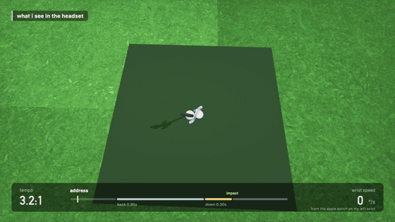
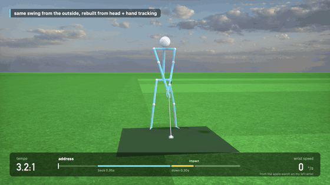

# Golf sim testing

A very (nonpolished) challenge i gave myself, after getting more into golf :D

The idea with this was to find a way to simulate a swing when hand tracking couldn't track my movement quickly enough, I found if I connected my apple watch via my iPhone, it could track hand posiitoning/rotation/speed a lot more effectively, without having to buy 3rd party controllers!

## What you'll see in the headset

Hand tracking will lock a club to your grip, as you swing, if the club hits the ball, physics engine will calculate where ball will go based off hit.

## Same swing from outside

Apple watch does motion 100x a second, tracks things like backswing/downswing time, wrist speed, face angle, etc. This works by connecting the watch to iPhone using bluetooth and watchConnectivity, and then iPhone will connect to vision pro over wifi.

Was a lot of fun to make this! Not very polished but feel free to try it yourself :D