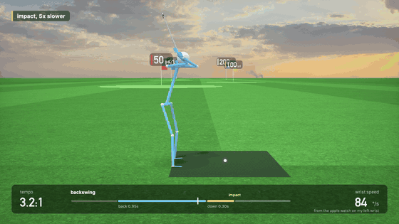
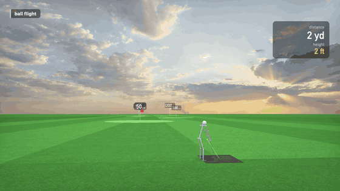
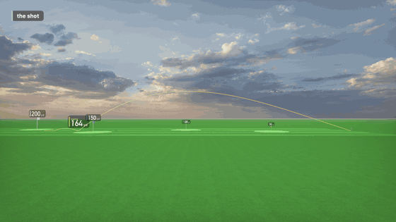

# golf sim testing

golf sim for vision pro. apple watch on ur wrist reads the swing, headset tracks ur hands + puts a club in them, ball flies off real physics

## what u see in the headset

hand tracking locks a club to ur grip when u hold still at address. swing it, club hits the ball, ball goes right then

## same swing from outside

apple watch on lead wrist does motion 100x a sec, works out backswing + downswing time (tempo), wrist speed, how smooth, face angle. goes watch -> iphone (bluetooth, watchconnectivity backup) -> vision pro over wifi

## impact

ball launches off hand speed + face angle from the hands the second u hit it, then the watch numbers come in a bit later + bend it onto the real path mid air

## ball flight

physics in SwingKit: wrist speed -> ball speed, face/path -> curve, drag + lift, then bounce + roll

## the shot

carry, total, apex, curve, tempo + a tip on the card. theres a putting green too

## stuff in here

- `Apps/VisionOS` headset app (range, putting, hand club)
- `Apps/Watch` swing sensor
- `Apps/iOS` relay + history
- `Packages/SwingKit` swing detection, flight + putt physics, shared msgs
- `tools/showcase` mac thing that rendered the gifs above
